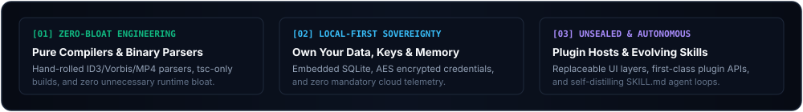
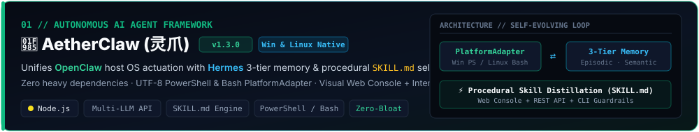
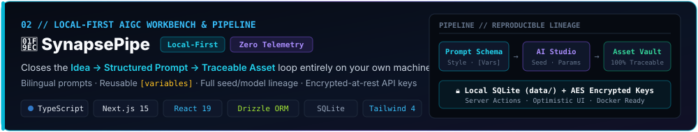
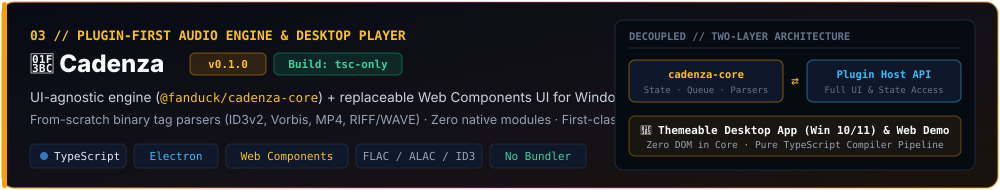
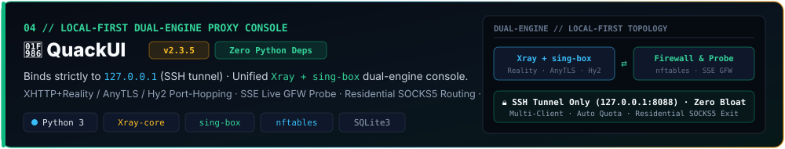
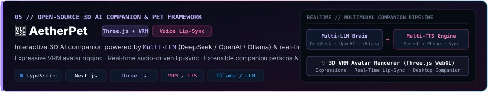

<div align="center">

<!-- CUSTOM TERMINAL HERO BANNER (ZERO EXTERNAL LATENCY) -->
<a href="https://github.com/FanDuck">
  
</a>

<br/>

<!-- REFINED GEOMETRIC TYPING LINE -->
<a href="https://github.com/FanDuck">
  
</a>

<!-- LIVE REPOSITORY CI & TELEMETRY BADGES -->
<p align="center">
  <a href="https://github.com/FanDuck/QuackUI/releases"></a>
  <a href="https://github.com/FanDuck/AetherClaw/actions"></a>
  <a href="https://github.com/FanDuck/cadenza/actions"></a>
  <a href="https://github.com/FanDuck/AetherPet"></a>
  <a href="https://github.com/FanDuck/SynapsePipe"></a>
  
  
  
</p>

</div>

---

### `❯ cat /etc/fanduck/manifesto.yaml`

```yaml
architect: "FanDuck"
focus:
  - Autonomous AI Agents & Procedural Skill Evolution (OpenClaw × Hermes paradigm)
  - Local-First Software & Reproducible Creative Pipelines (SQLite / Encrypted-at-Rest)
  - Decoupled Framework Design, Binary Protocol Parsing & Cross-Platform Tooling
  - Debian GNU/Linux Infrastructure, Containerization & Low-Latency Edge Networking
philosophy: >
  "Most software is a sealed box weighed down by bloated dependency trees and cloud lock-in.
   I build systems meant to be opened: zero-bloat cores, local-first data sovereignty,
   and autonomous workflows that run natively on your own metal."
```

<div align="center">
  
</div>

---

### `❯ ls -la ~/flagship-systems/`

> **Click any blueprint card below** to inspect the repository, or expand the technical dossier underneath for architecture notes & 1-minute quick starts.

#### 01 · [AetherClaw (灵爪)](https://github.com/FanDuck/AetherClaw) — *Self-Evolving Autonomous AI Agent Framework*

<a href="https://github.com/FanDuck/AetherClaw">
  
</a>

<p align="right">
  <sub>
    <a href="https://github.com/FanDuck/AetherClaw"><b>📦 Repository</b></a> ·
    <a href="https://github.com/FanDuck/AetherClaw/blob/main/README.en.md"><b>🌐 English Docs</b></a> ·
    <a href="https://github.com/FanDuck/AetherClaw/blob/main/docs/API_REFERENCE.md"><b>🔌 HTTP API</b></a> ·
    <a href="https://github.com/FanDuck/AetherClaw/releases"><b>🚀 Releases (v1.3.0)</b></a>
  </sub>
</p>

<details>
<summary><code>⚡ Inspect AetherClaw Architecture, Highlights &amp; Quick Start</code></summary>
<br/>

- **Why it exists:** Combines **OpenClaw's** real host actuation (terminal execution, file I/O, environment probing) with **Hermes Agent's** hierarchical memory and procedural **`SKILL.md` self-evolution**—engineered with **zero heavy dependency bloat**.
- **Key Systems Engineering:**
  - **Native `PlatformAdapter`**: Dispatches seamlessly to `powershell.exe` (with automatic UTF-8 normalization) on Windows or `bash` on Linux, guarded by regex safety policies and execution timeouts.
  - **3-Tier Memory (`MemoryAndSkillEngine`)**: Episodic traces (`Thought → Tool Call → Observation`), persistent Semantic facts (`data/memory.json`), and autonomous distillation of multi-step workflows into reusable `SKILL.md` modules.
  - **Dual Control Plane**: Ships with both a **Zero-Code Visual Web Console** and an **Interactive Terminal CLI**, plus a developer REST API.

```bash
git clone https://github.com/FanDuck/AetherClaw.git && cd AetherClaw
npm start
```
</details>

<br/>

#### 02 · [SynapsePipe](https://github.com/FanDuck/SynapsePipe) — *Local-First AIGC Workbench & Creative Pipeline*

<a href="https://github.com/FanDuck/SynapsePipe">
  
</a>

<p align="right">
  <sub>
    <a href="https://github.com/FanDuck/SynapsePipe"><b>📦 Repository</b></a> ·
    <a href="https://github.com/FanDuck/SynapsePipe/blob/main/README.md"><b>📖 English Docs</b></a> ·
    <a href="https://github.com/FanDuck/SynapsePipe/blob/main/README.zh-CN.md"><b>🇨🇳 中文文档</b></a> ·
    <a href="https://github.com/FanDuck/SynapsePipe#-architecture"><b>🏗️ Architecture</b></a>
  </sub>
</p>

<details>
<summary><code>⚡ Inspect SynapsePipe Pipeline Design, Highlights &amp; Quick Start</code></summary>
<br/>

- **Why it exists:** Most AIGC workflows leak—prompts get lost in chats, seeds hide in screenshots, and outputs pile up in `Downloads/`. **SynapsePipe** closes the **`Idea → Prompt → Assets`** loop inside a single local-first workspace.
- **Key Systems Engineering:**
  - **Structured Prompt Schema**: Prompts are first-class entities carrying bilingual copy, camera/style taxonomy, target model, aspect ratio, negative prompts, and dynamic `[variables]`.
  - **Deterministic Lineage**: Every generated or imported asset snapshots its exact prompt state, seed, model parameters, and tags for 100% reproducibility.
  - **Sovereign Local Storage**: Powered by **Next.js 15, React 19, TypeScript 5, Tailwind CSS v4, Drizzle ORM, and local SQLite (`data/`)** with encrypted-at-rest API keys and zero cloud telemetry.

```bash
git clone https://github.com/FanDuck/SynapsePipe.git && cd SynapsePipe
npm install && npm run dev
```
</details>

<br/>

#### 03 · [Cadenza](https://github.com/FanDuck/cadenza) — *Plugin-First Audio Framework & Desktop Player*

<a href="https://github.com/FanDuck/cadenza">
  
</a>

<p align="right">
  <sub>
    <a href="https://github.com/FanDuck/cadenza"><b>📦 Repository</b></a> ·
    <a href="https://github.com/FanDuck/cadenza/blob/main/docs/ARCHITECTURE.md"><b>🏗️ Architecture</b></a> ·
    <a href="https://github.com/FanDuck/cadenza/blob/main/README.zh-CN.md"><b>🇨🇳 中文说明</b></a> ·
    <a href="https://github.com/FanDuck/cadenza/releases"><b>💿 Windows Releases (v0.1.0)</b></a>
  </sub>
</p>

<details>
<summary><code>⚡ Inspect Cadenza Core Engine, Binary Parsers &amp; Quick Start</code></summary>
<br/>

- **Why it exists:** Most music players are sealed boxes. **Cadenza** splits the problem into a pure, headless engine (`@fanduck/cadenza-core`) and a replaceable, themeable desktop reference player (`apps/desktop`) where plugins enjoy the exact same privileges as built-in UI components.
- **Key Systems Engineering:**
  - **UI-Agnostic Core (`@fanduck/cadenza-core`)**: Zero DOM, zero Electron, and zero framework dependencies—manages playback state machines, queues, playlists, synchronized lyrics, and the plugin host.
  - **From-Scratch Binary Tag Parsers**: Hand-written in pure TypeScript with **no native node modules**—parses `ID3v2.2/2.3/2.4`, `Vorbis comments`, `MP4 atoms`, and `RIFF/WAVE` metadata + embedded cover art caching in a non-blocking process.
  - **Pure `tsc` Build Pipeline**: Compiles cleanly with the TypeScript compiler alone—no bundler complexity, shipping as portable/installer builds for Windows 10/11.

```bash
git clone https://github.com/FanDuck/cadenza.git && cd cadenza
pnpm install && pnpm demo
```
</details>

<br/>

#### 04 · [QuackUI](https://github.com/FanDuck/QuackUI) — *Local-First Dual-Engine (Xray + sing-box) Proxy Console*

<a href="https://github.com/FanDuck/QuackUI">
  
</a>

<p align="right">
  <sub>
    <a href="https://github.com/FanDuck/QuackUI"><b>📦 Repository</b></a> ·
    <a href="https://github.com/FanDuck/QuackUI/blob/main/README.md"><b>🇨🇳 中文文档</b></a> ·
    <a href="https://github.com/FanDuck/QuackUI/blob/main/README_EN.md"><b>🌐 English Docs</b></a> ·
    <a href="https://github.com/FanDuck/QuackUI/releases"><b>🚀 Releases (v2.3.5)</b></a>
  </sub>
</p>

<details>
<summary><code>⚡ Inspect QuackUI Dual-Engine Topology, GFW Probe &amp; Quick Start</code></summary>
<br/>

- **Why it exists:** Traditional proxy panels expose public management ports and pull heavy dependencies. **QuackUI** binds strictly to `127.0.0.1:8088` (accessed via SSH tunnel), runs on **pure Python 3 stdlib + SQLite3** (< 50 MB RAM), and unifies **Xray-core + sing-box** in one industrial console.
- **Key Systems Engineering:**
  - **Dual-Engine Protocols**: Supports `VLESS + XHTTP + Reality`, `VLESS + Vision + Reality`, `AnyTLS`, `Hysteria 2` (with automatic `nftables` UDP port hopping), `TUIC v5`, `Shadowsocks-2022`, `VMess`, and `Trojan`.
  - **Live SSE 5D Diagnostics & GFW Probe**: Streams real-time SNI TLS 1.3 checks, E2E latency, outbound IPv4 verification, CN block validation, and multi-city China TCP port probing via Globalping—with one-click IPv6 `/64` rotation.
  - **3x-ui Grade Ops**: Per-node multi-client management, 60s automated quota/expiration enforcement, residential SOCKS5 chained outbound routing, atomic `nftables` firewall sync, and Xray core version manager with auto-rollback.

```bash
git clone https://github.com/FanDuck/QuackUI.git && cd QuackUI
sudo bash install.sh
```
</details>

<br/>

#### 05 · [AetherPet](https://github.com/FanDuck/AetherPet) — *Open-Source 3D AI Companion & Pet Framework*

<a href="https://github.com/FanDuck/AetherPet">
  
</a>

<p align="right">
  <sub>
    <a href="https://github.com/FanDuck/AetherPet"><b>📦 Repository</b></a> ·
    <a href="https://github.com/FanDuck/AetherPet/blob/main/README.md"><b>📖 Documentation</b></a>
  </sub>
</p>

<details>
<summary><code>⚡ Inspect AetherPet Multimodal Pipeline &amp; Quick Start</code></summary>
<br/>

- **Why it exists:** Brings AI out of static chat boxes into a lively, interactive 3D desktop companion powered by open VRM avatars, pluggable LLM backends, and real-time voice lip-sync.
- **Key Systems Engineering:**
  - **Multi-LLM & Multi-TTS**: Seamlessly switches between DeepSeek, OpenAI, and local Ollama models paired with expressive speech synthesis.
  - **Real-Time Three.js + VRM**: Audio-driven lip-sync, facial expressions, and smooth 3D rendering in a modern TypeScript / Next.js architecture.

```bash
git clone https://github.com/FanDuck/AetherPet.git && cd AetherPet
npm install && npm run dev
```
</details>

---

### `❯ htop --tech-radar`

| Layer | Core Technologies & Protocols | Engineering Application |
| :--- | :--- | :--- |
| **🧠 Autonomous AI & Agents** |    | Episodic/Semantic/Procedural agent memory, tool-calling guardrails, reproducible prompt studios (`AetherClaw`, `SynapsePipe`) |
| **⚙️ Systems & Client Core** |     | Headless state machines, plugin host sandboxes, binary stream decoders, zero-bundler `tsc` pipelines (`Cadenza`) |
| **🌐 Modern Web & UI** |    | React Server Components, Server Actions, optimistic UI, Framer Motion micro-interactions (`SynapsePipe`) |
| **🗄️ Local-First Data** |    | Embedded relational persistence, schema migrations, zero-telemetry local vaults, binary tag & artwork caching |
| **🐧 Infra, Linux & Edge** |      | Cross-platform shell automation, zero-dependency Python daemons, atomic `nftables` firewalling, dual-engine edge networking (`QuackUI`) |

---

### `❯ git log --stat --oneline`

<div align="center">

| Project | Domain | Architecture Pattern | Stack | License |
| :--- | :--- | :--- | :--- | :---: |
| **[🦅 AetherClaw](https://github.com/FanDuck/AetherClaw)** | Autonomous AI Agent | `PlatformAdapter` + 3-Tier Memory + `SKILL.md` | `Node.js` · `JS` · `Web Console` · `CLI` | `MIT` |
| **[🧬 SynapsePipe](https://github.com/FanDuck/SynapsePipe)** | AIGC Creative Workbench | Local-First Pipeline + Deterministic Lineage | `Next.js 15` · `React 19` · `Drizzle` · `SQLite` | `MIT` |
| **[🎼 Cadenza](https://github.com/FanDuck/cadenza)** | Desktop Audio Framework | Headless Core + Plugin Host + Binary Parsers | `TypeScript` · `Electron` · `Web Components` | `MIT` |
| **[🦆 QuackUI](https://github.com/FanDuck/QuackUI)** | Dual-Engine Proxy Console | Local-First `127.0.0.1` + Atomic `nftables` + SSE Probe | `Python 3` · `Xray` · `sing-box` · `SQLite3` | `MIT` |
| **[🐾 AetherPet](https://github.com/FanDuck/AetherPet)** | 3D AI Companion Framework | Multi-LLM + Multi-TTS Lip-Sync + VRM Renderer | `TypeScript` · `Next.js` · `Three.js` · `VRM` | `MIT` |

<br/>

<sub>
  <code>EOF // Engineered with zero bloat by <a href="https://github.com/FanDuck">@FanDuck</a> · All systems operational.</code>
</sub>

</div>
